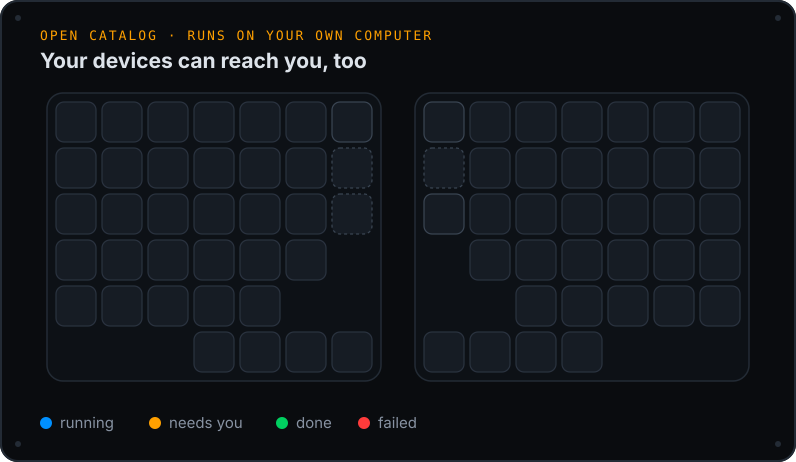

<p align="center">
  <picture>
    <source media="(prefers-color-scheme: dark)" srcset="assets/logo-dark.svg">
    
  </picture>
</p>

<h1 align="center">Hardpoint</h1>

<p align="center"><b>A safety label for everything your AI can touch.</b></p>

<p align="center">
  <a href="#what-it-is">What it is</a> ·
  <a href="#the-four-labels">The four labels</a> ·
  <a href="#try-it">Try it</a> ·
  <a href="#add-a-device">Add a device</a> ·
  <a href="docs/DESIGN.md">Design</a> ·
  <a href="docs/SPEC.md">Card format</a>
</p>

<p align="center">
  
</p>

## What it is

AI helpers are starting to do things, not just answer questions. Hardpoint
gives each device a plain label: what an AI may look at, what it may change,
and what only you can do.

The name comes from engineering. A hardpoint is the reinforced, load-rated
spot on a vehicle where equipment is allowed to attach. A device's label is
the same idea: the places software may attach, each rated for what it can
safely carry.

| Part | What it does |
|---|---|
| **The catalog** | One card per device model: how to recognise it, what it can do, how risky each change is, and how much of that a person has checked. Data only. |
| **The daemon** | Runs on your computer and is the only thing that touches hardware. Everything it knows about a device comes from that device's card. |
| **The site** | Generated from the catalog, with a machine-readable feed for any tool. |

The first thing built on it: agent sessions shown on keyboard keys you never
use. Each session gets a key, the colour is its state, and pressing the key
runs an action of your own for that session.

## The four labels

Every ability a device has gets one of four labels. Colour always means the
same thing, here and on the site.

| Label | In everyday words | Like |
|---|---|---|
| `read` | Just looking | Reading a thermometer |
| `reversible` | Easy to undo | A dimmer switch |
| `guarded` | Checks with you first | "Keep these display settings?" |
| `gated` | Only you can do this | Changing the locks |

<p align="center">
  
</p>

| Risk | What the daemon does |
|---|---|
| `read` | Reads the value. |
| `reversible` | Applies the change and records the previous value. |
| `guarded` | Applies it, then puts it back unless you confirm within a few seconds. |
| `gated` | Never does it. It explains the steps a person has to take. |

A card cannot claim a lower risk than the shared vocabulary allows for that
capability, and anything `guarded` or `gated` has to say, in plain words, what
goes wrong if it is done carelessly.

## What runs today

| | Status |
|---|---|
| Catalog format, validator, generated site and feed | Runs |
| Discovery: matching attached devices to cards | Runs on macOS |
| A keyboard driven entirely from its card: lights, key presses, layers | Runs on macOS, on one keyboard |
| Agent sessions on keys, and a press that runs your own action | Runs, with OpenCode and any script |
| Brightness that follows the clock; per-key press counts | Runs |
| Reading a mouse and the computer through adapters | Designed. Read by hand so far |
| Confirm-or-revert, and a journal of every change | Designed |
| An MCP server for any agent and model provider | Designed |
| Linux | Not tried |

Each device's page on the site shows, capability by capability, what has been
tested and what has only been read about.

## Try it

It needs Rust to build the daemon, and Python 3.12 or newer to build the site.

```sh
cargo build --release

# What is attached, and which cards describe it
./target/release/hardpoint inventory

# No hardware needed: prints which keys would be lit
./target/release/hardpoint run --device dry --config examples/moonlander.toml

# In another terminal, report an agent's state the way a hook or script would
./target/release/hardpoint emit --source my-tool --session 1 --state needs-you
./target/release/hardpoint status
```

Agent states are `idle`, `running`, `needs-you`, `done` and `failed`.

To drive a real keyboard, copy an example from [`examples/`](examples) to
`~/.config/hardpoint/config.toml`, choose which keys are slots, and run
`hardpoint run`. Only one program can hold a keyboard's control channel, so
the vendor's own app has to be closed while Hardpoint runs.

Nothing about a device or a person is built into the program. The built-in
settings in [`config/default.toml`](config/default.toml) name no device and
no keys.

## Add a device

1. Copy a card in [`catalog/devices/`](catalog/devices) to
   `catalog/devices/<vendor>/<model>.toml`.
2. Fill in how the device is recognised under `[[match]]`. `hardpoint
   inventory` lists what it sees for anything not yet in the catalog.
3. List each capability with a word from
   [the vocabulary](catalog/vocabulary/capabilities.toml). If the word you
   need is missing, add it in the same change.
4. Be exact in `verification`. `tested` means you exercised it through the
   named adapter. `observed` means you saw it work some other way.
   `unverified` means you only read about it.
5. Run `python3 tools/build.py --check`.

The rules are in [docs/SPEC.md](docs/SPEC.md).

## What it will not do

| | |
|---|---|
| **Cards are data** | A card names an adapter and gives it typed values. It can never carry a command, a script or a path, and the validator rejects any field it does not know. |
| **Risk has a floor** | Anything that cannot be undone is never done by software alone. |
| **It stays on your computer** | No account, no server. The daemon listens on a local socket only you can write to. |
| **Counts, not keystrokes** | To act on a press the daemon sees which key went down. It keeps per-key counts only if you turn that on, and never the order, the timing or the text. |

The one place a command can come from is your own config file: the action
you choose to run when you press a slot.

## Layout

```text
catalog/        device cards, the vocabulary, the adapter list, the schema
src/            the daemon
config/         built-in settings
examples/       complete setups to copy
site-src/       the site's words, styles and scripts
tools/build.py  validates the catalog; builds the site, the feed and assets/
docs/           the design and the card format
```

## Licence

- **Catalog data** in `catalog/`: CC0 1.0, in [LICENSE-DATA](LICENSE-DATA).
  No attribution is required, so any tool can ship it.
- **Everything else**: Apache 2.0, in [LICENSE](LICENSE).

By contributing a card you agree to release it under CC0. Write cards from
your own observation and from documentation; do not copy data files from
projects whose licences would not allow that.

Product names belong to their owners. This project is not affiliated with them.
