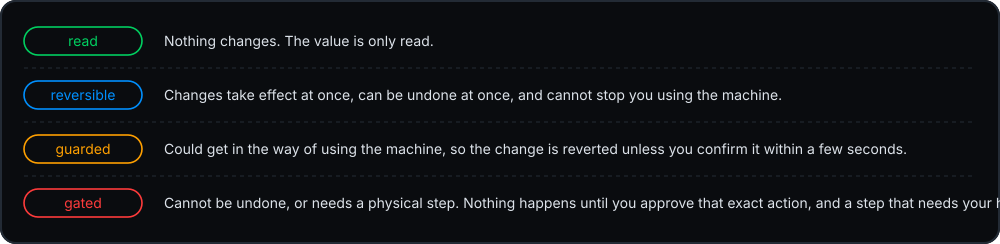

<p align="center">
  <picture>
    <source media="(prefers-color-scheme: dark)" srcset="assets/logo-dark.svg">
    
  </picture>
</p>

<h1 align="center">Hardpoint</h1>

<p align="center"><b>Let your agent manage your devices. You stay in charge.</b></p>

<p align="center">Bring your own agent: Claude Code, Codex, OpenCode, or any LLM with a terminal.</p>

<p align="center">
  <a href="https://dotcipher.github.io/hardpoint/">Site</a> ·
  <a href="#what-it-is">What it is</a> ·
  <a href="#why-not-let-the-agent-work-it-out">Why not let the agent work it out?</a> ·
  <a href="#the-four-labels">The four labels</a> ·
  <a href="#try-it">Try it</a> ·
  <a href="#add-a-device">Add a device</a> ·
  <a href="docs/DESIGN.md">Design</a> ·
  <a href="docs/SPEC.md">Card format</a>
</p>

<p align="center">
  
</p>

## What it is

Your agent already works in your files and your terminal. Hardpoint adds
your devices: a checked card for each one says what it can read, what it may
change, and what needs your yes first.

The name comes from engineering. A hardpoint is the reinforced, load-rated
spot on a vehicle where equipment is allowed to attach. A device's card is
the same idea: the places software may attach, each rated for what it can
safely carry.

| Part | What it does |
|---|---|
| **The catalog** | One card per device model: how to recognise it, what it can do, how risky each change is, and how much of that a person has checked. Data only. |
| **The daemon** | Runs on your computer and is the only thing that touches hardware. Everything it knows about a device comes from that device's card. |
| **The site** | Generated from the catalog, with a machine-readable feed for any tool. |

A card works both ways. The first thing built on it lets your devices reach
you: agent sessions shown on keyboard keys you never use. Each session gets a
key, the colour is its state, and pressing the key runs an action of your own
for that session.

## Why not let the agent work it out?

Claude Code, Codex or any LLM with a terminal can already try to control a
device: it searches, writes a command and runs it. This is what changes with
Hardpoint.

| | Claude Code, Codex or any LLM agent | The same agent, with Hardpoint |
|---|---|---|
| **Knowing your device** | Has never seen your exact device. It searches, then works from whatever it finds. | Reads a card written for that exact model. |
| **Knowing the risk** | Reading a battery and replacing firmware look the same to it: a command to run. | Every ability on a card has one of four labels, set before anyone asks. |
| **Proof** | Reports what it did. Nothing says whether that was ever checked on your model. | Each claim on a card says whether a person tested it on a real device, and links to the record. |
| **Touching the device** | Writes its own commands and runs them as you. | A card holds no commands. Only Hardpoint's own program ever touches a device. |
| **When it goes wrong** | If a change locks you out, you are on your own. | A risky change is labelled to go back by itself unless you keep it. One that cannot be undone waits for your yes. |
| **What it learns** | Gone when the session ends. The next agent works it out again. | A card is checked once and shared. Everyone with that device gets it, in any agent. |

That table describes the cards. [What runs today](#what-runs-today) says how
much of it the program acts on so far.

## The four labels

Every ability on a card gets one of four labels.

<p align="center">
  
</p>

| Label | What happens when an agent asks |
|---|---|
| `read` | It looks, and tells you. |
| `reversible` | It makes the change, and can put it back. |
| `guarded` | It makes the change, then asks you to keep it. If you do not answer, it goes back. |
| `gated` | It gets everything ready and asks first. Nothing happens until you say yes. |

A card cannot claim a lower risk than the shared vocabulary allows for that
capability, and anything `guarded` or `gated` has to say, in plain words, what
goes wrong if it is done carelessly.

## What runs today

| | Status |
|---|---|
| Catalog format, validator, generated site and feed | Runs |
| Discovery: matching attached devices to cards | Runs on macOS |
| A keyboard driven entirely from its card: lights, key presses, layers | Runs on macOS, on one keyboard |
| Agent sessions on keys, and a press that runs your own action | Runs, with OpenCode and any script |
| Brightness that follows the clock; per-key press counts | Runs |
| Reading a mouse and the computer through adapters | Designed. Read by hand so far |
| Confirm-or-revert, and a journal of every change | Designed |
| Approve-first changes, such as firmware updates | Designed |
| An MCP server for any agent and model provider | Designed |
| Linux | Not tried |

Each device's page on [the site](https://dotcipher.github.io/hardpoint/devices.html)
shows, capability by capability, what has been tested and what has only been
read about.

## Try it

It needs Rust to build the daemon, and Python 3.11 or newer to build the site.

```sh
cargo build --release

# What is attached, and which cards describe it
./target/release/hardpoint inventory

# No hardware needed: prints which keys would be lit
./target/release/hardpoint run --device dry --config examples/moonlander.toml

# In another terminal, report an agent's state the way a hook or script would
./target/release/hardpoint emit --source my-tool --session 1 --state needs-you
./target/release/hardpoint status
```

Agent states are `idle`, `running`, `needs-you`, `done` and `failed`.

To drive a real keyboard, copy an example from [`examples/`](examples) to
`~/.config/hardpoint/config.toml`, choose which keys are slots, and run
`hardpoint run`. Only one program can hold a keyboard's control channel, so
the vendor's own app has to be closed while Hardpoint runs.

Nothing about a device or a person is built into the program. The built-in
settings in [`config/default.toml`](config/default.toml) name no device and
no keys.

## Add a device

A card is one small file. Adding one needs no code and changes nothing on
your device.

**With Claude Code, Codex or any coding agent:** open the
[Add a device](https://dotcipher.github.io/hardpoint/add.html) page, press
Copy, and paste. The prompt has it list what is plugged in, ask which device
you mean, and write the card with you.

**By hand:**

```sh
python3 tools/observe.py             # what is plugged in, and what has no card yet
python3 tools/observe.py --draft 3   # start a card for one of them
python3 tools/build.py --check       # check it
```

Be exact about what was checked: `observed` is for something you ran and saw
work, `unverified` for something you only read about.
[CONTRIBUTING.md](CONTRIBUTING.md) has the rest, and
[docs/SPEC.md](docs/SPEC.md) the full rules.

## What keeps it in your hands

| | |
|---|---|
| **Cards are data** | A card names an adapter and gives it typed values. It can never carry a command, a script or a path, and the validator rejects any field it does not know. |
| **Risk has a floor** | A card cannot give an ability a lower label than the shared vocabulary allows. |
| **No undo, no surprise** | Anything that cannot be undone waits for your approval of that exact action, every time. A step that needs your hands, such as a button on the device, stays yours. |
| **It stays on your computer** | No account, no server. The daemon listens on a local socket only you can write to. |
| **Counts, not keystrokes** | To act on a press the daemon sees which key went down. It keeps per-key counts only if you turn that on, and never the order, the timing or the text. |

The one place a command can come from is your own config file: the action
you choose to run when you press a slot.

## Layout

```text
catalog/        device cards, the vocabulary, the adapter list, the schema
src/            the daemon
config/         built-in settings
examples/       complete setups to copy
site-src/       the site's words, styles and scripts
tools/build.py  validates the catalog; builds the site, the feed and assets/
tools/observe.py  lists attached devices and drafts a card for one
docs/           the design and the card format
```

## Licence

- **Catalog data** in `catalog/`: CC0 1.0, in [LICENSE-DATA](LICENSE-DATA).
  No attribution is required, so any tool can ship it.
- **Everything else**: Apache 2.0, in [LICENSE](LICENSE).

By contributing a card you agree to release it under CC0. Write cards from
your own observation and from documentation; do not copy data files from
projects whose licences would not allow that.

Product names belong to their owners. This project is not affiliated with them.
